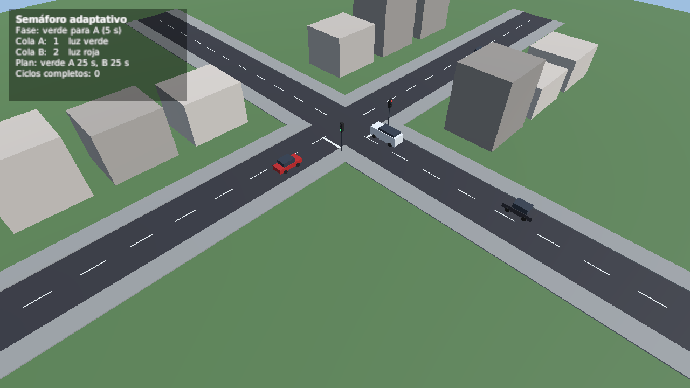
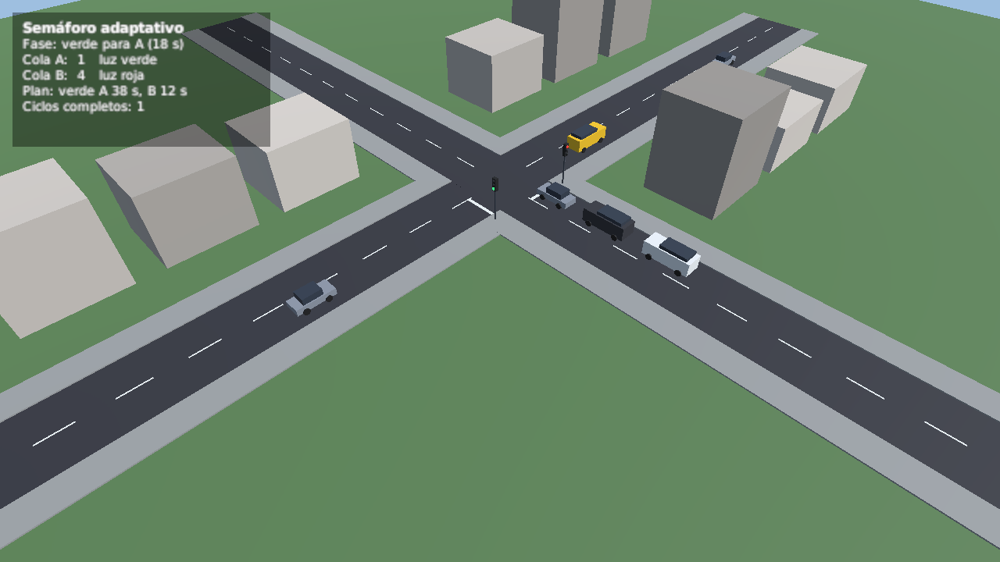

# unity-simulacion-semaforo

Simulación en Unity de una intersección con un semáforo que reparte el verde
según cuántos autos esperan en cada calle. Es la parte en Unity del proyecto
final de Inteligencia Artificial (julio de 2025), hecho en grupo; la parte en
Python, que cuenta los vehículos con YOLOv8 y estima el riesgo con lógica
difusa, está en
[ia-practicas](https://github.com/Whiteherobot/ia-practicas/tree/main/07-semaforo-inteligente).


| Al empezar | Ciclo siguiente: más verde para A |
|---|---|
|  |  |

- Dos calles de un sentido se cruzan: A (de oeste a este, con más tráfico) y B
  (de sur a norte). Los autos, camionetas y buses llegan al azar.
- Cada vehículo acelera hasta unos 40 km/h, frena para no pasar la línea con
  rojo (con amarillo solo si alcanza a detenerse) y guarda distancia con el de
  adelante.
- Cada carril cuenta su cola (los vehículos a menos de 60 m de la línea), como
  lo haría la cámara del proyecto original.
- El ciclo dura 60 s: verde, 3 s de amarillo y 2 s de todo rojo para cada
  carril. Al empezar cada ciclo, el verde (50 s en total) se reparte en
  proporción a las colas, con un mínimo de 12 s por carril. Es la misma regla
  que el programa en Python, sin la parte difusa.
- El panel muestra la fase, el tiempo que le queda, las colas y el plan.

## Abrir y compilar

Con Unity 6.5 (6000.5.2f1): abrir la carpeta en Unity Hub y luego
`Assets/Escenas/Interseccion.unity`. El menú **Simulación** vuelve a crear la
escena y compila para Linux o Windows. Por línea de comandos:

```bash
Unity -batchmode -quit -projectPath . -executeMethod SimulacionSemaforo.Editor.Construir.Linux
Builds/Linux/Simulacion.x86_64 -batchmode -capturas capturas/   # guarda tres imágenes y se cierra
```

## Estructura

```
Assets/Scripts/Logica/       reparto del verde y fases del semáforo (C# sin Unity)
Assets/Scripts/Simulacion/   escena: calles, vehículos, postes, panel y capturas
Assets/Editor/Construir.cs   crea la escena y el material, y compila
Assets/Tests/EditMode/       pruebas de la lógica
Assets/Tests/PlayMode/       pruebas sobre la escena real
```

Todo se arma con primitivas y un solo material; no hay modelos ni texturas de
terceros.

## Pruebas

```bash
Unity -batchmode -projectPath . -runTests -testPlatform EditMode -testResults editmode.xml
Unity -batchmode -projectPath . -runTests -testPlatform PlayMode -testResults playmode.xml
```

EditMode (10): reparto proporcional, mínimos, las seis fases, que nunca haya
dos verdes a la vez y que cada ciclo lea las colas de ese momento. PlayMode
(5): un auto se detiene antes de la línea con rojo, cruza con verde, varios
autos se detienen en fila sin chocar, los postes muestran la luz correcta y el
ciclo siguiente usa las colas contadas.

No tiene CI: correr Unity en GitHub Actions necesita los datos de una licencia
como secretos del repo.

## De dónde sale

En el proyecto, cada cámara de la simulación mandaba una foto a un servidor
Flask (en una IP fija de la red de la universidad) que contaba los autos y
devolvía la señal. En el repo (antes `SImulacionCar`) solo quedaron los
scripts, una escena vacía y dos paquetes de autos del Asset Store, que no se
pueden publicar; el servidor y la escena de la intersección no se subieron. En
2026 se rehízo la simulación sin assets de terceros y con el conteo dentro de
Unity, y se pasó a Unity 6.5.

## Autores

Michael Lata ([@Whiteherobot](https://github.com/Whiteherobot)), Jorge Cueva,
Michael Franco y Bryam Mejía.

Licencia MIT.
